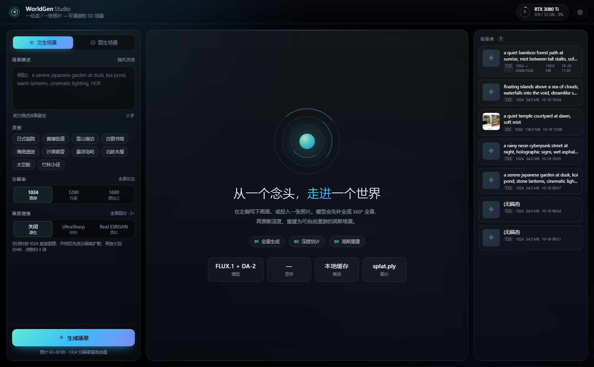
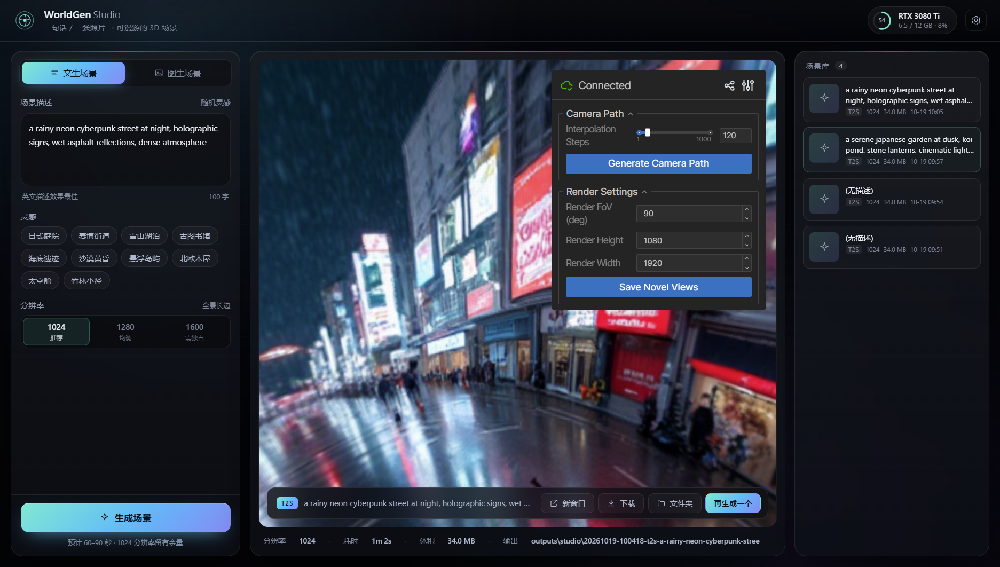
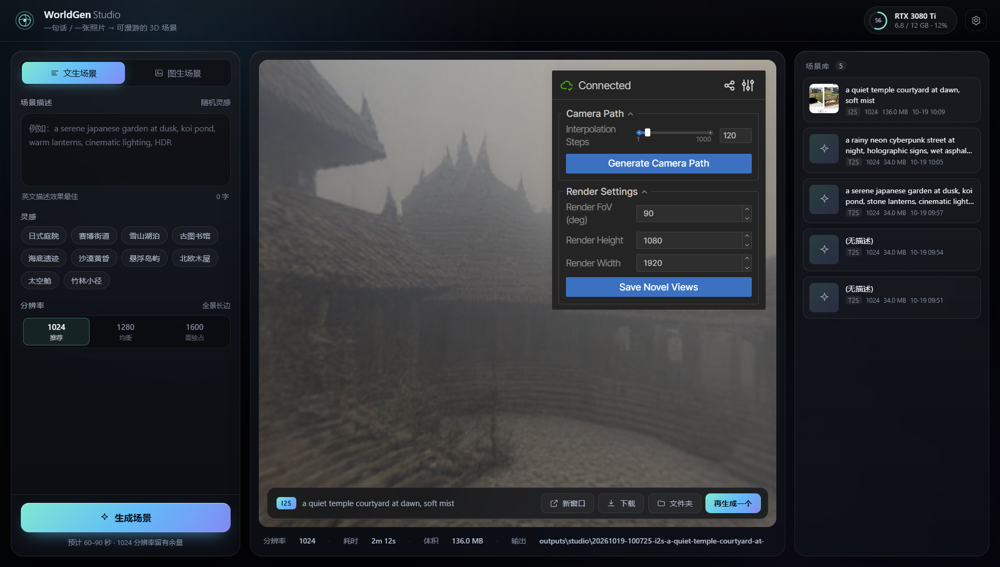

# WorldGen Studio

> 写一句话，或丢一张照片，得到一个可以走进去的 3D 世界。

WorldGen Studio 是 [WorldGen](https://github.com/ZiYang-xie/WorldGen) 的本地图形界面：它把「文本/图片 → 360° 全景 → 单目深度 → 3D 高斯点云」这条链路包装成一个可点击的应用，并把 12GB 显存跑通这条链路所需的内存调度、阶段隔离和超分增强都做在了里面。



<p align="center">
  
  
</p>

## 这个仓库做了什么

WorldGen 本身是一个研究项目：命令行入口、50 步扩散、约 12GB 峰值显存、生成完不会退出。直接用它需要熟悉 Python 环境和显存调度。这个项目在**不修改 WorldGen 源码**的前提下补齐了这些：

| 能力 | 说明 |
|---|---|
| **图形界面** | 本地 Web 应用，参数面板 / 环形进度 / 实时日志 / 场景库，独立窗口运行 |
| **12GB 显存可用** | 通过运行时补丁把 T5-XXL、深度模型在正确的时机挪出显存，把峰值从 11.95GB（卡死）压到 10.9GB |
| **阶段级进程隔离** | 每次生成独立子进程，结束即释放 CUDA context，不会越跑越吃显存 |
| **卡死自动终止** | Windows 显存超限不会抛 OOM，只会 100% 占用且无输出；看门狗会在长时间无日志时终止并给出诊断 |
| **全景超分** | 1024 宽扩散 → cubemap 六面 4× 超分 → 反投影回 2048，高斯点从 52 万提到 210 万 |
| **一键安装** | `install.bat` 负责 venv、依赖、源码、补丁、校验 |

## 环境要求

| 项目 | 要求 |
|---|---|
| 操作系统 | Windows 10/11（主要支持）；Linux 理论上可用，脚本需要自行调整 |
| GPU | NVIDIA，**≥ 12GB 显存**（RTX 3060 12G / 3080 Ti / 4070 Ti 及以上） |
| 驱动 | 支持 CUDA 12.8 的驱动（≥ 570） |
| Python | **3.11 或 3.12**（3.13 不可用，torch cu128 与 nunchaku 只提供 cp312 轮子） |
| 磁盘 | 约 60GB（依赖 ~8GB + 模型 ~40GB + 输出） |
| Git | 需要（用于拉取 WorldGen 源码） |

显存越小越需要 `low_vram` 路径；16GB 以上可以尝试 1600 原生分辨率，但本项目默认按 12GB 调优。

## 快速开始

### 1. 安装

```bat
git clone https://github.com/liubinw2004/WorldGen-Studio.git
cd WorldGen-Studio
install.bat
```

国内网络建议：

```bat
install.bat --mirror
```

安装脚本会依次完成：定位 Python → 创建 `venv` → 安装 torch(CUDA)/nunchaku/worldgen → 拉取 WorldGen 源码与必需子模块 → 注册运行时补丁 → 校验导入。

> 首次安装约 10–20 分钟，取决于网速。中途失败可以重跑，已完成的步骤会跳过。

### 2. 准备模型

**模型需要你自己下载**（体积大，且 FLUX.1-dev 需要接受许可）。装完 `install.bat` 会打印一份清单，也可以随时查看：

```bat
venv\Scripts\python.exe scripts\check_models.py
```

必装 4 项：

```bat
:: 先让下载命令使用项目内的缓存目录
call env\set_env.bat

:: 1) WorldGen LoRA（t2s + i2s，约 80MB）
huggingface-cli download LeoXie/WorldGen

:: 2) 全景深度模型 DA-2（约 1.3GB）
huggingface-cli download haodongli/DA-2

:: 3) 4bit FLUX 主干（约 4GB，12GB 显存的关键）
huggingface-cli download mit-han-lab/svdq-int4-flux.1-dev
```

第 4 项 `FLUX.1-dev` 是 **gated** 模型，需要先在 [模型页](https://huggingface.co/black-forest-labs/FLUX.1-dev) 接受许可，然后：

```bat
huggingface-cli login
huggingface-cli download black-forest-labs/FLUX.1-dev ^
  --include "model_index.json" "scheduler/*" "text_encoder/*" "text_encoder_2/*" ^
            "tokenizer/*" "tokenizer_2/*" "vae/*" ^
  --local-dir models\FLUX.1-dev
```

**不要**下载 `flux1-dev.safetensors`（23.8GB）：4bit 主干已经替代了它，装了也用不上。

<details>
<summary>图生场景（i2s）额外需要</summary>

```bat
call env\set_env.bat
huggingface-cli download mit-han-lab/svdq-int4-flux.1-fill-dev
huggingface-cli download black-forest-labs/FLUX.1-Fill-dev ^
  --include "model_index.json" "scheduler/*" "transformer/config.json" ^
  --local-dir models\FLUX.1-Fill-dev
:: text_encoder / text_encoder_2 / tokenizer* / vae 可从 FLUX.1-dev 复制
```

</details>

<details>
<summary>超分权重（可选，各约 67MB）</summary>

放到 `models\sr\`：

- `4x-UltraSharp.pth` — [下载](https://huggingface.co/uwg/upscaler/resolve/main/ESRGAN/4x-UltraSharp.pth)（更锐利，推荐）
- `RealESRGAN_x4plus.pth` — [下载](https://github.com/xinntao/Real-ESRGAN/releases/download/v0.1.0/RealESRGAN_x4plus.pth)（更柔和）

不装也能正常生成，只是「画质增强」开关不可用。

</details>

### 3. 启动

```bat
start.bat
```

浏览器会打开一个独立应用窗口。停止服务用 `stop.bat`。

## 使用

界面分三栏：

- **左**：模式（文本/图像）、场景描述、灵感预设、分辨率、画质增强
- **中**：环形进度、阶段时间线、实时日志；生成完成后是 3D 查看器
- **右**：场景库，历史产物可直接回看、下载、打开目录

几个实际经验：

- **分辨率**：1024 是 12GB 卡上最稳的选择；1280 需要关闭其他占 GPU 的程序；1600 会吃满显存。
- **画质增强**：先按 1024 扩散，再把全景超分到 2048 重建，点数 ×4，耗时只多约 1.5 秒。显存峰值不叠加（扩散模型先被卸载）。图像模式不适用——它补全出的全景本身已是 2048。
- **图像模式**：普通透视照片即可，模型会自动补全成 360°。
- 生成完成后查看器会占着显存；下一次生成会自动回收，也可以先按停止。

## 命令行

不用界面也能跑：

```bat
call env\set_env.bat
venv\Scripts\python.exe scripts\run_i2s_watchdog.py ^
  -p "a quiet bamboo forest at sunrise, mist, god rays" ^
  -o outputs\cli-run -r 1024 --low_vram --save_scene
```

开启超分：

```bat
set WG_SR_MODEL=ultrasharp
set WG_SR_SCALE=2
venv\Scripts\python.exe scripts\run_i2s_watchdog.py ...
```

单独的图像超分工具：

```bat
venv\Scripts\python.exe -m srlab.run_sr ^
  --pano outputs\pano.png --model ultrasharp --out outputs\pano_2x.png --target-width 2048
```

## 项目结构

```
.
├── install.bat / start.bat / stop.bat   一键安装 / 启动 / 停止
├── config.py                            路径与环境的唯一真源
├── app/                                 图形界面（Flask + 原生前端）
│   ├── server.py                        HTTP 接口
│   ├── runner.py                        子进程调度、日志解析、看门狗
│   └── static/                          界面
├── srlab/                               全景超分（cubemap 重投影 + RRDB）
├── vendor/
│   ├── worldgen_i2s_shim/               显存调度补丁（不修改上游源码）
│   ├── worldgen_sr_shim/                超分注入补丁
│   └── pytorch3d_shim/                  Windows 上替代 pytorch3d 的两个数学函数
├── scripts/
│   ├── bootstrap.py                     安装逻辑
│   ├── check_models.py                  模型校验
│   ├── patch_worldgen.py                让模型可放在 models/ 而非 HF 缓存结构
│   └── legacy/                          历史分步脚本（仅作参考）
└── docs/                                设计文档与排障记录
```

`WorldGen/`、`models/`、`cache/`、`venv/`、`outputs/` 都不在版本库内：前四个由安装脚本和用户生成，输出是运行产物。

## 工作原理（简）

1. **文本/图像 → 全景**：FLUX.1-dev + WorldGen LoRA，输出 1024×512 的等距柱状全景。
2. **（可选）超分**：全景切成 6 个带 6% 余量的透视面 → 每面 4× RRDB 超分 → 面积缩放到目标尺寸 → 带羽化的反投影拼回，极区回退双三次避免角分辨率不足。
3. **深度**：DA-2（SphereViT）估计全景距离；它在内部把输入缩放到约 60 万像素，所以深度几何与全景分辨率无关，超分提高的是**颜色与点数**。
4. **高斯化**：每个全景像素生成一个高斯点，得到 `.ply`。

显存调度是三个阶段串行、互斥访问：扩散（6.6GB）→ 释放 → 超分（0.6GB）→ 释放 → 深度 + 高斯化（1.3GB）。峰值出现在扩散阶段，因此开启超分不会抬高峰值。

更多细节见 [`docs/DEVIATIONS.md`](docs/DEVIATIONS.md)——它记录了显存静默卡死、日志管道背压、全景接缝亮线、超分权重键名不匹配等问题的完整定位过程。

## 排障

**生成时卡在 100% GPU、日志不动**
Windows 显存超限不会报错，只会静默换页。看门狗会在 8 分钟无输出后终止。处理：关闭浏览器硬件加速/游戏/其他推理进程，或降到 1024。

**`CUDA out of memory`**
显存被别的程序占着。`nvidia-smi` 看一下，`stop.bat` 能清掉残留的推理进程。

**启动报「没有找到虚拟环境」**
先跑 `install.bat`。

**`check_models.py` 说模型缺失，但我下载了**
确认下载时 `HF_HOME` 指向项目内（先 `call env\set_env.bat`），或者用 `--local-dir` 直接放到位。

**界面能开，但生成失败**
看 `app/logs/server.log` 与 `outputs/studio/<任务>/run.log`，后者是推理子进程的完整输出。

## 致谢

- [WorldGen](https://github.com/ZiYang-xie/WorldGen) — 全景生成与高斯重建流程
- [FLUX.1-dev](https://huggingface.co/black-forest-labs/FLUX.1-dev)、[nunchaku](https://github.com/mit-han-lab/nunchaku) — 生成与 4bit 推理
- [DA-2](https://github.com/EnVision-Research/DA-2) — 全景深度
- [Real-ESRGAN](https://github.com/xinntao/Real-ESRGAN)、[4x-UltraSharp](https://huggingface.co/uwg/upscaler) — 超分权重

## 许可

本仓库的胶水代码（`app/`、`srlab/`、`vendor/`、`scripts/`）以 MIT 发布。WorldGen 源码与各模型权重遵循其各自许可——FLUX.1-dev 为非商用许可，使用前请阅读对应条款。
